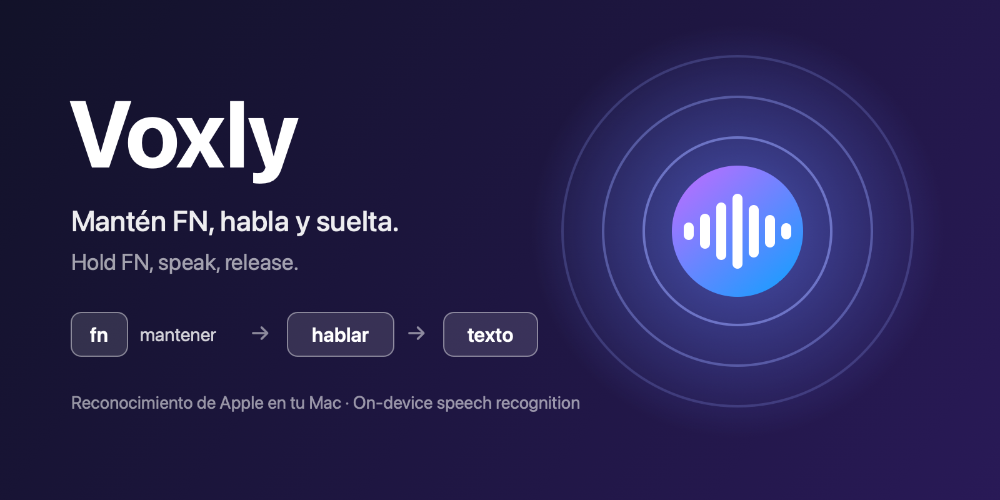

<p align="center">
  
</p>

# Voxly

**Mantén FN, habla, suelta: tu voz se escribe donde tengas el cursor.**
**Hold FN, speak, release: your voice is typed wherever your cursor is.**

[Español](#español) · [English](#english)

---

## Español

Voxly es una pequeña app de barra de menús para macOS que convierte tu voz en texto en cualquier aplicación. Usa el reconocimiento de voz integrado de Apple (framework `Speech`), sin servicios de terceros ni claves de API.

### Características
- **Pulsar para hablar:** mantén **FN** mientras hablas; al soltar, el texto se inserta en la ventana activa.
- **Bola animada** con efecto de latido que reacciona al volumen de tu voz.
- **En tu Mac:** usa reconocimiento en el dispositivo cuando el idioma lo admite, de modo que el audio no sale del equipo.
- **Varios idiomas** seleccionables desde el menú: español (España y México), inglés (EE. UU. y Reino Unido), francés, alemán, italiano y portugués.
- Restaura tu portapapeles después de pegar el texto.

### Requisitos
- macOS 13 o superior.
- Xcode Command Line Tools (`xcode-select --install`) para compilar.

### Instalar
**Opción 1: instalador (recomendada).** Descarga la última versión, verifica su SHA-256, la copia a `/Applications` y la abre. Al no pasar por el navegador, no salta el aviso de macOS:
```bash
curl -fsSL https://raw.githubusercontent.com/oski02/Voxly/main/install.sh | bash
```
Puedes leer el script antes de ejecutarlo: [`install.sh`](install.sh).

**Opción 2: descarga manual.** Baja `Voxly-1.1-macOS.zip` desde [Releases](https://github.com/oski02/Voxly/releases), descomprímelo y mueve `Voxly.app` a `/Applications`. La primera vez macOS dirá que *no ha podido verificar que Voxly no contenga software malicioso*, porque la app no está notarizada por Apple. Para abrirla:
1. Intenta abrirla y pulsa **Aceptar**.
2. Ve a **Ajustes del Sistema → Privacidad y seguridad**, baja a *Seguridad* y pulsa **Abrir de todos modos**.

   O bien, en la Terminal: `xattr -dr com.apple.quarantine /Applications/Voxly.app`

**Opción 3: compilar desde el código** (una app compilada en tu Mac no recibe el aviso):
```bash
git clone https://github.com/oski02/Voxly.git
cd Voxly
./build.sh
cp -R build/Voxly.app /Applications/
open /Applications/Voxly.app
```

### Permisos
Voxly te pedirá:
1. **Micrófono** y **Reconocimiento de voz**: para transcribir lo que dices.
2. **Accesibilidad**: para detectar la tecla FN y pegar el texto.
3. **Monitorización de entrada**: solo si tu versión de macOS la exige para detectar FN. La app te lo indica en el menú.

macOS no permite que una app se conceda permisos a sí misma: hay que activarlos en *Ajustes del Sistema → Privacidad y seguridad*. El menú del icono muestra con ✅/❌ cuáles faltan.

### Configuración recomendada
En *Ajustes del Sistema → Teclado*, pon **"Pulsar la tecla 🌐 para"** en **No hacer nada**, para que FN no abra el selector de emojis ni el dictado del sistema.

### Notas
- La app se firma de forma *ad-hoc*. Cada vez que la recompilas, macOS la considera una app nueva y hay que volver a conceder los permisos. Con un certificado de firma propio se evita.
- El texto se inserta simulando `Cmd+V`, por lo que no funciona en campos que bloquean el pegado.
- El modelo de reconocimiento es el de Apple; Voxly no permite elegirlo.

---

## English

Voxly is a small macOS menu-bar app that turns your voice into text in any application. It uses Apple's built-in speech recognition (`Speech` framework), with no third-party services or API keys.

### Features
- **Push to talk:** hold **FN** while you speak; on release, the text is inserted into the active window.
- **Animated orb** with a heartbeat effect that reacts to your voice level.
- **On-device:** uses on-device recognition when the language supports it, so audio stays on your Mac.
- **Multiple languages** selectable from the menu: Spanish (Spain, Mexico), English (US, UK), French, German, Italian and Portuguese.
- Restores your clipboard after pasting the text.

### Requirements
- macOS 13 or later.
- Xcode Command Line Tools (`xcode-select --install`) to build.

### Install
**Option 1: installer (recommended).** Downloads the latest release, verifies its SHA-256, copies it to `/Applications` and opens it. Since it doesn't go through a browser, the macOS warning doesn't appear:
```bash
curl -fsSL https://raw.githubusercontent.com/oski02/Voxly/main/install.sh | bash
```
You can read the script before running it: [`install.sh`](install.sh).

**Option 2: manual download.** Get `Voxly-1.1-macOS.zip` from [Releases](https://github.com/oski02/Voxly/releases), unzip it and move `Voxly.app` to `/Applications`. The first time, macOS will say it *could not verify that Voxly is free of malware*, because the app is not notarized by Apple. To open it:
1. Try to open it and click **Done**.
2. Go to **System Settings → Privacy & Security**, scroll to *Security* and click **Open Anyway**.

   Or, in Terminal: `xattr -dr com.apple.quarantine /Applications/Voxly.app`

**Option 3: build from source** (an app built on your own Mac doesn't get the warning):
```bash
git clone https://github.com/oski02/Voxly.git
cd Voxly
./build.sh
cp -R build/Voxly.app /Applications/
open /Applications/Voxly.app
```

### Permissions
Voxly will ask for:
1. **Microphone** and **Speech Recognition**: to transcribe what you say.
2. **Accessibility**: to detect the FN key and paste the text.
3. **Input Monitoring**: only if your macOS version requires it to detect FN. The app shows this in its menu.

macOS does not let an app grant permissions to itself: enable them in *System Settings → Privacy & Security*. The menu-bar icon shows with ✅/❌ which ones are missing.

### Recommended setting
In *System Settings → Keyboard*, set **"Press 🌐 key to"** to **Do Nothing**, so FN doesn't open the emoji picker or system dictation.

### Notes
- The app is *ad-hoc* signed. Every rebuild looks like a new app to macOS, so permissions must be granted again. A self-managed signing certificate avoids this.
- Text is inserted by simulating `Cmd+V`, so it won't work in fields that block pasting.
- The recognition model is Apple's; Voxly doesn't let you choose it.

---

## Licencia / License
[MIT](LICENSE) © x25s
